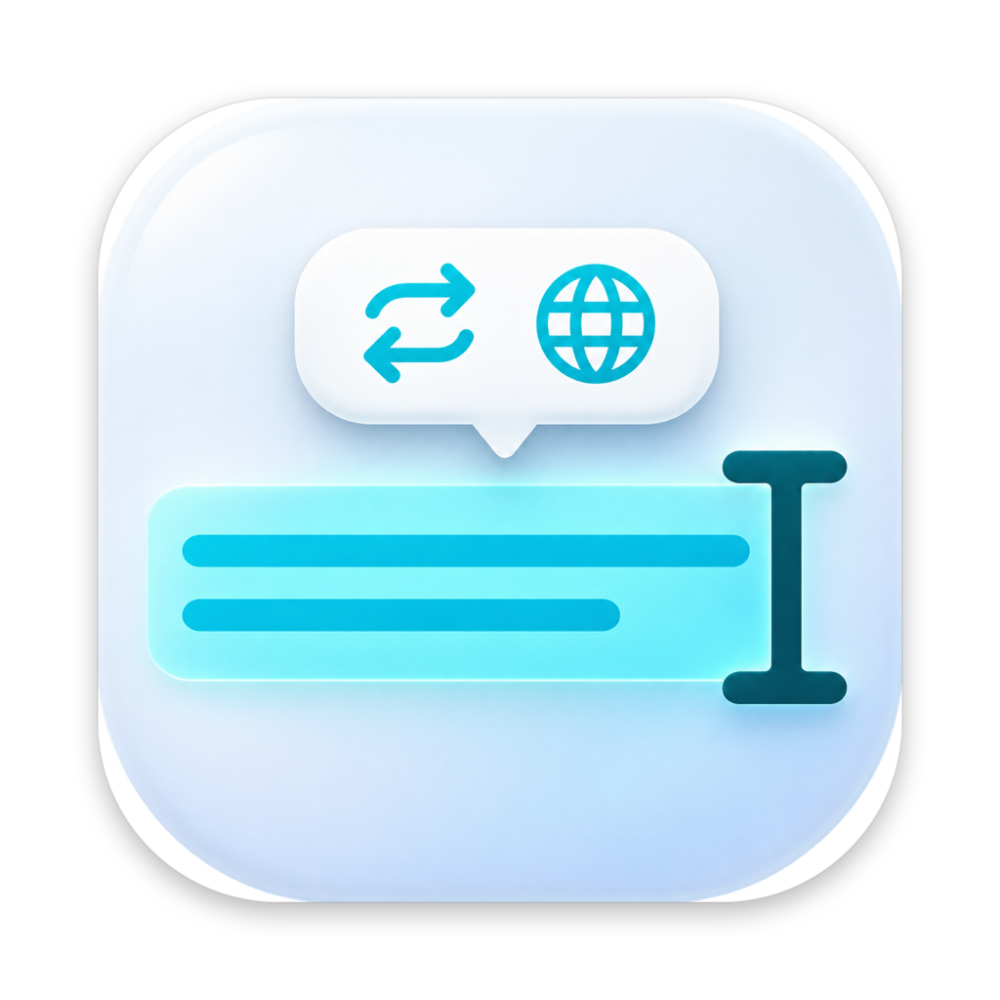
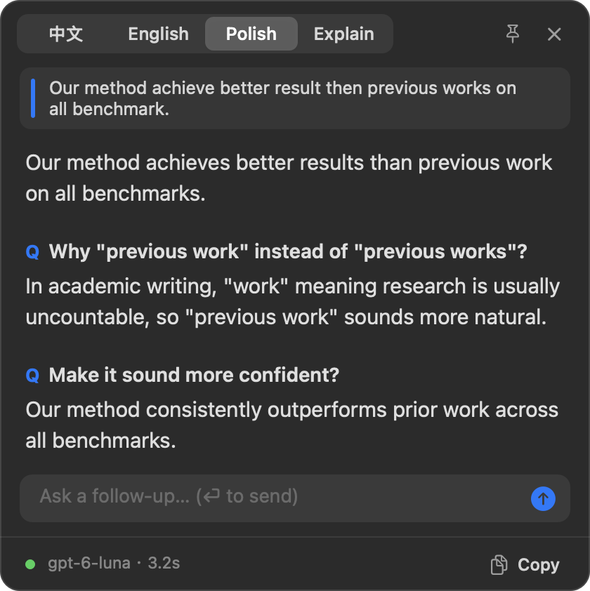
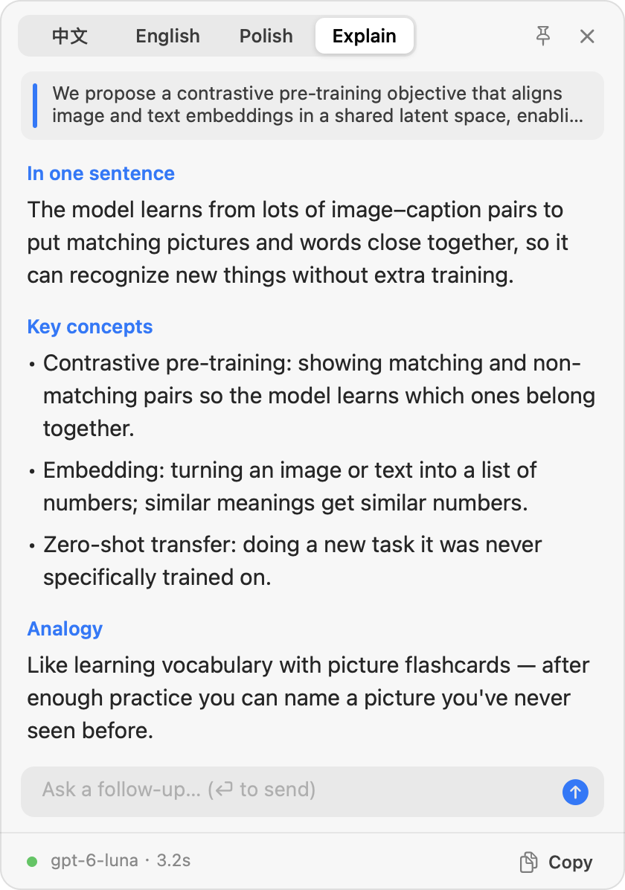
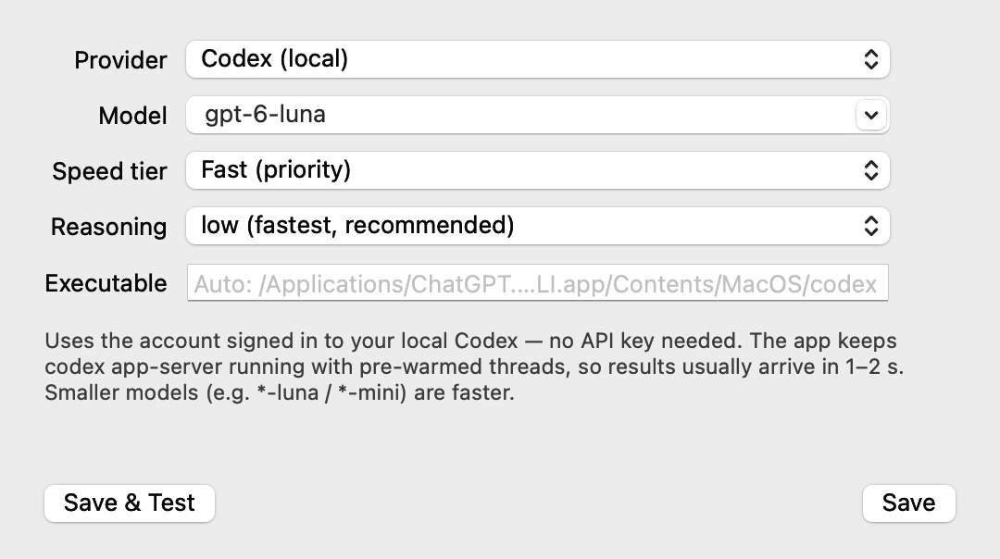

<div align="center">



# Select Translate · 划线翻译

**System-wide select-to-translate / polish / explain for macOS, with follow-up chat.<br>Powered by your local Codex or Claude Code, or any OpenAI / Anthropic compatible API.**

[](https://github.com/catoneone/select-translate/actions/workflows/build.yml)
[](https://github.com/catoneone/select-translate/releases)

[](LICENSE)

English · [中文](README.md)

<br>


</div>

## Features

- **Works in any app**: drag-select, double-click a word, or Shift+click, and a small toolbar appears next to the cursor.
- **Four modes**:
  - **中文**: translate to Simplified Chinese.
  - **English**: translate to natural English.
  - **Polish**: fix grammar and wording, keeping the original language.
  - **Explain**: explain a passage in plain words a high-school student can follow (great for reading papers), organized as *In one sentence / Key concepts / Analogy*.
- **Follow-up chat**: ask questions under any result. The original text, the result, and previous Q&A are sent as context.
- **Streaming output**, one-click copy, and ⌘C copies only the selected part.
- **Pluggable providers**:

  | Provider | Notes |
  | --- | --- |
  | **Codex (local)** | Uses the account signed in to your Codex CLI / ChatGPT desktop app. No API key needed. Keeps `codex app-server` running with pre-warmed threads, so a translation typically takes **1–2 s**. |
  | **Claude Code (local)** | Uses your signed-in Claude Code. No API key needed. Keeps a spare CLI process pre-started to hide cold-start latency. |
  | **OpenAI-compatible API** | OpenAI, DeepSeek, Moonshot, Qwen, OpenRouter, Ollama, and any other Chat Completions compatible endpoint. |
  | **Anthropic API** | Claude Messages API, or a compatible proxy. |

- Frosted-glass cards with light / dark mode. Windows never steal focus; pin a window or press Esc to close it.

- **Launch at Login**: toggle it from the menu bar icon (managed under System Settings → General → Login Items).
- **English & Chinese UI**: menu bar icon → **Language** (System Default / 中文 / English). In English mode, explanations and follow-up answers are in English too.

<p align="center">

&nbsp;

</p>

## Install

1. Download `SelectTranslate-*.zip` from [Releases](https://github.com/catoneone/select-translate/releases) and move **SelectTranslate.app** to `/Applications`.
2. The app is not notarized, so run this once before opening it:
   ```bash
   xattr -dr com.apple.quarantine /Applications/SelectTranslate.app
   ```
3. Grant **Accessibility** permission when prompted. It's needed to read the selected text.
4. Click the menu bar icon → **Settings…** to choose a provider. The UI follows your system language; change it under **Language**.

### Build from source

Requires the Xcode Command Line Tools (`xcode-select --install`).

```bash
git clone https://github.com/catoneone/select-translate.git
cd select-translate
./build.sh --install   # builds a universal binary and installs it to /Applications
```

Builds are ad-hoc signed by default, so macOS treats every rebuild as a new app and asks for Accessibility permission again.
Sign with a fixed (even self-signed) certificate via `SIGN_ID` to keep the permission across rebuilds; see the header of `build.sh`.

## Providers

- **Codex**: install the [Codex CLI](https://github.com/openai/codex) or the ChatGPT / Codex desktop app and sign in. Leave the model empty to use your `~/.codex/config.toml` default, or pick a small model (e.g. `*-mini`) for speed. The Fast / Ultrafast service tiers are optional.
  - **Why it's fast**: the first turn of a fresh Codex thread costs 3–8 s for connection setup, warm-up, and context building, while later turns on the same thread take about 1 s and hit the prompt cache. So the app keeps two warm threads and rotates them every 40 requests. Tools, plugins, and MCP are disabled, and the sandbox is read-only.
- **Claude Code**: `npm i -g @anthropic-ai/claude-code`, then run `claude` once to sign in. The default model is `haiku`. It runs with `--tools ""` and `--strict-mcp-config`.
- **OpenAI-compatible**: set the Base URL (e.g. `https://api.deepseek.com`, `http://localhost:11434/v1` for Ollama), the API key, and the model.
- **Anthropic**: Base URL `https://api.anthropic.com`, model e.g. `claude-haiku-4-5`.

API keys are stored in the macOS Keychain.

## Privacy

Selected text is sent only to the provider you choose. The app itself collects nothing.
Logs (`~/Library/Logs/SelectTranslate/`) contain status information only, never your text.

## Development

```bash
APP=build/SelectTranslate.app/Contents/MacOS/SelectTranslate
$APP --selftest "Hello world"     # run all modes with the current provider and time them
$APP --chattest                   # explain + follow-up questions
$APP --render ./preview           # render UI screenshots offscreen
```

See the source layout in the [Chinese README](README.md#开发).

## License

[MIT](LICENSE)
