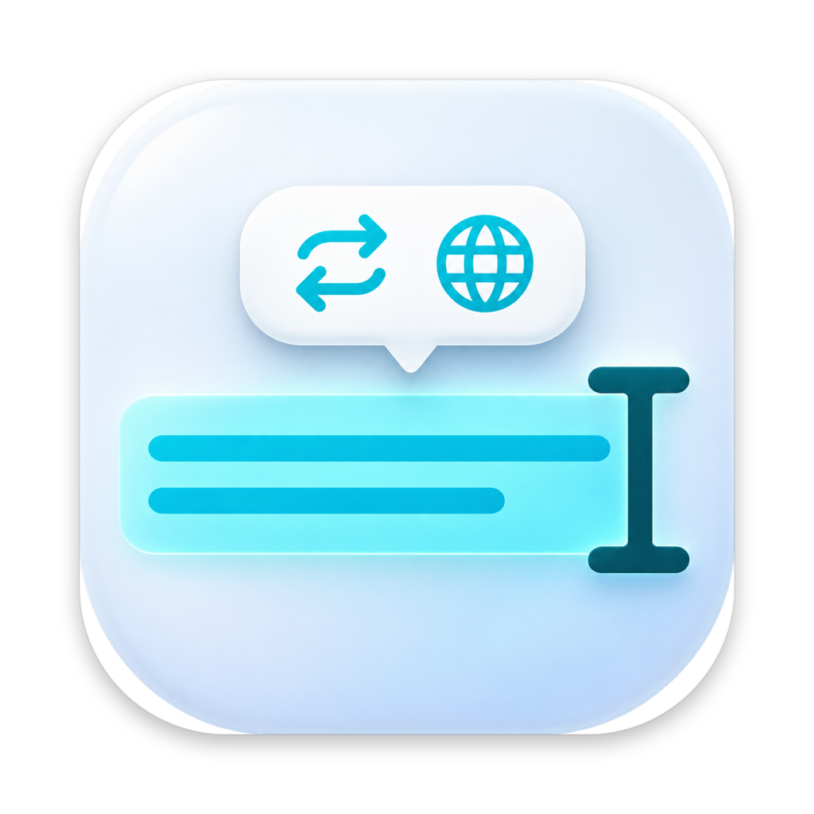
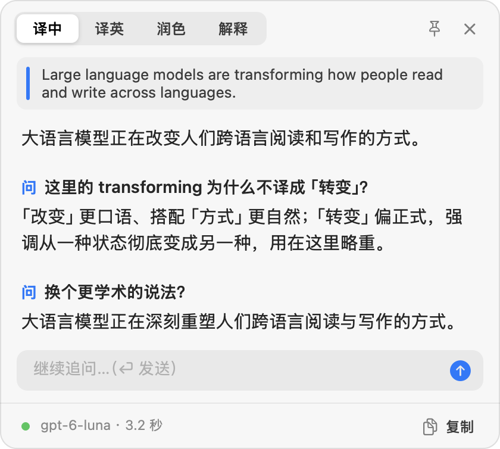
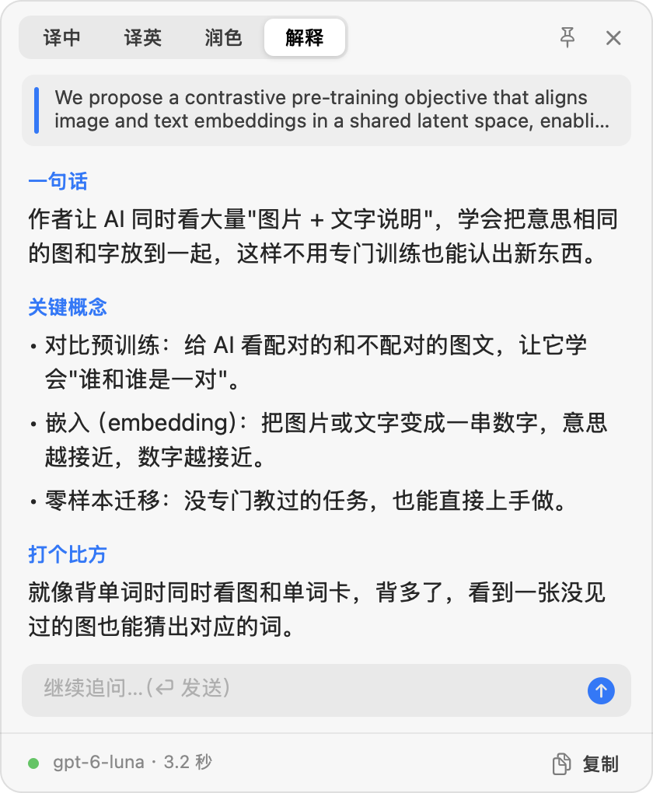
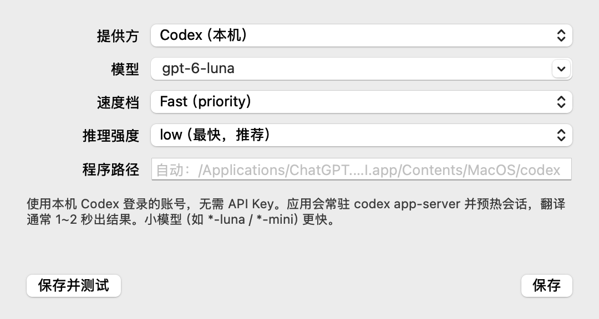

<div align="center">



# 划线翻译 · Select Translate

**macOS 全局划词翻译 / 润色 / 解释，支持追问。<br>直接使用本机的 Codex、Claude Code，或任意 OpenAI / Anthropic 兼容 API。**

[](https://github.com/catoneone/select-translate/actions/workflows/build.yml)
[](https://github.com/catoneone/select-translate/releases)

[](LICENSE)

[English](README.en.md) · 中文

<br>


</div>

## 功能

- **任意应用划词**：拖选、双击选词或 Shift+点击，光标旁弹出工具条。
- **四种模式**：
  - **译中**：翻译成简体中文。
  - **译英**：翻译成地道英文。
  - **润色**：保持原语言，修正语法、改进表达。
  - **解释**：用高中生也能听懂的话讲解一段话（适合读论文），按「一句话 / 关键概念 / 打个比方」组织。
- **追问对话**：每个结果下方都能继续提问，自动带上原文、结果和历史问答作为上下文。
- **流式输出**：边生成边显示；可一键复制，选中部分文字按 ⌘C 只复制选中内容。
- **多种模型来源**，在设置里切换：

  | 提供方 | 说明 |
  | --- | --- |
  | **Codex（本机）** | 使用本机 Codex CLI / ChatGPT 桌面版登录的账号，无需 API Key。常驻 `codex app-server` 并预热会话，翻译通常 **1~2 秒**。 |
  | **Claude Code（本机）** | 使用本机 Claude Code 登录的账号，无需 API Key。预先启动备用进程，减少 CLI 冷启动等待。 |
  | **OpenAI 兼容 API** | OpenAI、DeepSeek、Moonshot、通义千问、OpenRouter、本地 Ollama 等任何兼容 Chat Completions 的服务。 |
  | **Anthropic API** | Claude Messages API，也支持兼容的代理地址。 |

- **好看且不打扰**：毛玻璃卡片，深色 / 浅色自适应；窗口不抢焦点，📌 固定或 Esc 关闭。
- **中文 / English 界面**：菜单栏图标 → **界面语言**（跟随系统 / 中文 / English）。英文界面下，「解释」和追问也用英文回答。

<p align="center">

&nbsp;

</p>

## 安装

### 下载

1. 在 [Releases](https://github.com/catoneone/select-translate/releases) 下载 `SelectTranslate-*.zip`，解压后把 **SelectTranslate.app** 拖进「应用程序」。
2. 应用未经 Apple 公证，首次打开前在终端执行：
   ```bash
   xattr -dr com.apple.quarantine /Applications/SelectTranslate.app
   ```
3. 打开应用，按屏幕顶部的提示授予 **辅助功能** 权限（系统设置 → 隐私与安全性 → 辅助功能），用于读取选中的文字。
4. 菜单栏出现图标后即可使用。点图标 → **设置…** 选择模型提供方。

### 从源码构建

需要 Xcode Command Line Tools（`xcode-select --install`），无需打开 Xcode。

```bash
git clone https://github.com/catoneone/select-translate.git
cd select-translate
./build.sh --install     # 构建通用二进制并安装到 /Applications
```

`./build.sh` 只构建到 `build/`，`./build.sh --zip` 会打包发布用的 zip。

> **提示**：默认是 ad-hoc 签名，每次重新构建后 macOS 会把它当成新应用，需要重新授权辅助功能。
> 自己开发时可以用一个固定的（自签名）证书签名，授权就能一直保留，详见 `build.sh` 顶部的 `SIGN_ID` 说明。

## 配置模型提供方

首次启动时会自动检测：找到本机 Codex 就用 Codex，其次 Claude Code；都没有则打开设置窗口。

### Codex（本机）

- 安装 [Codex CLI](https://github.com/openai/codex) 或 ChatGPT / Codex 桌面版，并完成登录。应用会优先使用桌面版内置的新版 CLI。
- **模型**：留空则使用 `~/.codex/config.toml` 中的默认模型。翻译这种简单任务建议选小模型（如 `*-mini`、`*-luna`），会快很多。下拉框会列出你账号可用的模型。
- **速度档**：可选 Fast（priority）或 Ultrafast（取决于账号和模型是否支持）。
- **推理强度**：建议 `low`。

> **为什么这么快？** Codex 每个新会话的第一轮要建立连接、预热、构建上下文（3~8 秒），之后同一会话里每轮只要约 1 秒，还能命中提示词缓存。所以应用启动时会在后台预热 2 个会话轮流复用，每个会话用 40 次后自动换新。翻译只用纯文本，所有工具、插件、MCP 都已禁用，且只读沙箱。

### Claude Code（本机）

- `npm i -g @anthropic-ai/claude-code`，然后在终端运行一次 `claude` 完成登录。
- **模型**：`haiku`（最快，默认）/ `sonnet` / `opus`，或完整模型名。
- 以 `--tools ""`、`--strict-mcp-config` 运行，不使用任何工具，也不加载 MCP。

### OpenAI 兼容 API

| 服务 | Base URL | 模型示例 |
| --- | --- | --- |
| OpenAI | `https://api.openai.com/v1` | `gpt-4o-mini` |
| DeepSeek | `https://api.deepseek.com` | `deepseek-chat` |
| Moonshot | `https://api.moonshot.cn/v1` | `moonshot-v1-8k` |
| 通义千问 | `https://dashscope.aliyuncs.com/compatible-mode/v1` | `qwen-plus` |
| OpenRouter | `https://openrouter.ai/api/v1` | `openai/gpt-4o-mini` |
| Ollama（本地） | `http://localhost:11434/v1` | `qwen2.5:7b`（API Key 可留空） |

### Anthropic API

Base URL 默认 `https://api.anthropic.com`，模型如 `claude-haiku-4-5`。

API Key 保存在 **macOS 钥匙串**中，不会写入配置文件。

## 使用技巧

- 结果窗顶部可以随时切换模式；再点一次当前模式就重新生成。
- 追问后窗口会自动固定，点击别处也不会关闭；Esc 或 ✕ 关闭。
- 菜单栏图标 → **模型提供方** 可快速切换；**启用划词** 可临时关闭；勾选 **开机自动启动** 即可随系统启动（可在 系统设置 → 通用 → 登录项 中管理）。
- 读取选中文字时优先使用辅助功能 API。读不到时（部分 Chrome / Electron 应用）会模拟 ⌘C 读取，并立即恢复你原来的剪贴板。

## 隐私

- 选中的文字只会发送给你选择的模型提供方（本机 Codex / Claude Code 账号，或你配置的 API）。应用本身不收集、不上传任何数据。
- 日志位于 `~/Library/Logs/SelectTranslate/`，只记录运行状态，不记录选中的文字和模型回复。

## 开发

```
Sources/
├── main.swift              入口与命令行自测
├── L10n.swift              界面语言（中文 / English）
├── App.swift               菜单栏、全局鼠标 / 键盘监听
├── Selection.swift         读取选中文字（辅助功能 API / 模拟 ⌘C）
├── Prompts.swift           各模式提示词、追问提示词
├── SettingsStore.swift     设置、钥匙串
├── SettingsWindow.swift    设置窗口
├── UI.swift                工具条、结果卡片、提示卡片
└── Providers/
    ├── Provider.swift          统一接口
    ├── CodexProvider.swift     codex app-server（JSON-RPC）+ 预热会话池
    ├── ClaudeCodeProvider.swift claude CLI（stream-json）+ 备用进程
    └── APIProviders.swift      OpenAI 兼容 / Anthropic（SSE 流式）
assets/                     图标：icon-source.png（Codex 生成的原图）→ AppIcon.icns
tools/make-icon.swift       图标处理：规范到 Apple 图标网格、圆角裁切、投影、生成 .icns
```

重新生成图标：`swift tools/make-icon.swift assets/icon-source.png assets/AppIcon.icns`

命令行自测，无需界面：

```bash
APP=build/SelectTranslate.app/Contents/MacOS/SelectTranslate
$APP --selftest "Hello world"          # 用当前提供方跑全部模式并计时
$APP --selftest "一段论文文字" 解释      # 只测某个模式
$APP --chattest                        # 测试解释 + 连续追问
$APP --render ./preview                # 离屏渲染界面截图（加参数 en 渲染英文界面）
```

欢迎提交 Issue 和 PR。

## License

[MIT](LICENSE)
